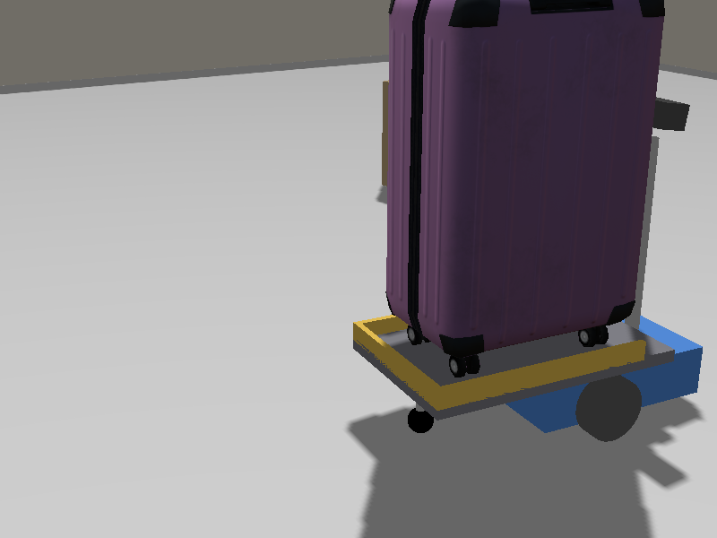

# AI ポーターロボット（ROS 2 × Gazebo × YOLO）

ロビーに置き忘れられたスーツケースを、ロボットが**自分で探して受け取り、障害物を避けながらお客様の席（折りたたみ椅子）まで届ける**シミュレーションです。
Physical AI 応用1講座の最終課題として作成しました。



## 動作の流れ

| 段階 | 内容 | 使うセンサー |
|---|---|---|
| 1. 探す・近づく | その場で回りながらカメラ画像を YOLO で判定し、スーツケースを見つけたら近づいて止まる | カメラ、LiDAR |
| 3. 受け取る | スーツケースを荷台に載せて固定する | — |
| 1. 探す・近づく | 折りたたみ椅子を探して向かう | カメラ、LiDAR |
| 2. 避ける | 通り道の箱を「障害物」と見分け、空いている側から回り込んで探し直す | カメラ、LiDAR |
| 3. 届ける | 椅子の正面にスーツケースを置き、少し下がって YOLO で置いた荷物を確認する | カメラ |

途中の状況は、すべて日本語のログで表示されます。

```
[段階1/探索] スーツケースを発見しました（確信度 85%、画面の右寄り、推定 約1.9m 先）
[段階3/受取] スーツケースを固定しました。このまま運びます
[段階2/回避] 正面 0.60m に障害物があります（折りたたみ椅子はまだ約 3.2m 先）
[段階2/回避] 左の空き 平均2.9m / 右の空き 平均2.9m → 左へ回り込みます
[段階3/配達] 椅子の正面（位置 x=-1.66, y=1.50）にスーツケースを置きました
[段階3/確認] 置いたスーツケースをカメラで確認できました（確信度 54%）
[完了] スーツケースを折りたたみ椅子の前に届けました。配達完了です
```

## AI の使い方

- **YOLOv8n（COCO データセットで学習済み）の推論**で、カメラ画像から `suitcase` と `chair` を見つけます。
- 見つけた物の**画面上の位置**で進む向きを決め、**枠の高さと実物の高さ**から距離を推定します。
- **目的の物と障害物の見分け方**：LiDAR で測った正面の距離が、カメラの推定距離より 0.5m 以上近ければ、正面の物は目的の物ではなく障害物と判断します。
- 配達後は、置いたスーツケースが見えるかを YOLO で確認してから完了とします。
- 目的以外の検出結果（例：赤い箱を「stop sign」と誤検出）は使いません。

## 環境

- Windows 11 + Docker Desktop（WSL 2）。Ubuntu の PC でも動きます
- Docker イメージ `airobotbook/ros2-desktop-ai-robot-book-humble`（Ubuntu 22.04 / ROS 2 Humble / Ignition Gazebo Fortress / Ultralytics）
- NVIDIA GPU（任意）。GPU があれば YOLO を GPU で動かします。なくても CPU で動きます

## セットアップ

1. このリポジトリを取得します。
   ```bash
   git clone https://github.com/uchiduck9-dev/pai-final-porter-robot.git
   ```
2. 取得したフォルダで、PowerShell からコンテナを作成します（初回のみ。2回目以降は `docker start pai_final`）。
   ```powershell
   .\run_final_container.ps1
   ```
   ブラウザで http://localhost:6081 を開くと、コンテナのデスクトップ画面が表示されます。このフォルダはコンテナ内の `/workspace` につながっています。
3. デスクトップのターミナルで、YOLO の学習済みモデル（yolov8n.pt）を取得します（約6MB、初回のみ）。
   ```bash
   mkdir -p /workspace/weights && cd /workspace/weights && python3 -c "from ultralytics import YOLO; YOLO('yolov8n.pt')"
   ```
4. ビルドします。
   ```bash
   cd /workspace/ros2_ws && colcon build
   ```

## 実行（ターミナル3つ）

| ターミナル | 役割 | コマンド |
|---|---|---|
| A | シミュレーション（Gazebo と ROS 2 のブリッジ） | `source /workspace/ros2_ws/install/setup.bash && ros2 launch pai_final_bot sim.launch.py` |
| B | ポーターロボット（日本語ログ） | `source /workspace/ros2_ws/install/setup.bash && ros2 launch pai_final_bot porter.launch.py` |
| C | ロボットの目線と YOLO の判定 | `ros2 run rqt_image_view rqt_image_view`（`/porter/detections` を選択） |

A を起動して3秒ほど待ってから B を起動します。スタートから完了まで約70秒です。
もう一度動かすときは、A を Ctrl+C で止めて起動し直してください（ロボットと荷物が初期位置に戻ります）。

キーボードで操作したい場合は、A を `ros2 launch pai_final_bot sim.launch.py teleop:=true` で起動します。

## 主な設定値

`ros2 run pai_final_bot porter_node --ros-args -p 名前:=値` で変更できます。

| 名前 | 既定値 | 意味 |
|---|---|---|
| `targets` | `['suitcase', 'chair']` | 訪れる順番（YOLO のクラス名） |
| `min_confidence` | 0.45 | これ未満の判定は無視する |
| `confirm_frames` | 3 | 何回続けて見えたら「発見」とするか |
| `stop_distance` | 0.55 | 目的の物にこの距離 [m] まで近づいたら止まる |
| `avoid_distance` | 0.6 | 障害物がこの距離 [m] より近づいたら回避を始める |
| `carry` | true | 荷物を運ぶ（false なら探して近づくだけ） |

## フォルダ構成

```
ros2_ws/src/pai_final_bot/
  pai_final_bot/porter_node.py   ロボットの頭脳（探索・接近・回避・受取・配達）
  launch/sim.launch.py           シミュレーションとブリッジの起動
  launch/porter.launch.py        ポーターノードの起動
  config/bridge.yaml             ROS 2 と Gazebo のトピックの対応
  worlds/arena.sdf               広場（壁・障害物・スーツケース・椅子）
  models/diffbot/                ロボット（差動二輪・カメラ・LiDAR・荷台）
  models/suitcase/, folding_chair/  3D モデル（出典は下記）
tools/                           動作確認・診断用のスクリプトと、物体選びの記録画像
run_final_container.ps1          コンテナの作成
```

## 工夫した点

- **YOLO が認識できる物体を実験で選んだ。** 十数個の候補を並べて検出率を比べ、大きさが広場に合い、見てすぐ分かる物（スーツケースと折りたたみ椅子）を選びました（`tools/lineup_*.png`）。
- **認識しやすい環境に調整した。** カメラを床から46cmのマストの上に上げ、壁を明るい色にし、照明の向きを変えました。カメラが低いと、物を足元から見上げる形になり、検出されにくくなります。
- **画像の遅れへの対策。** Gazebo の画面表示で負荷が高いと、YOLO が古い画像を判定し続ける問題が起きました。常に最新の1枚だけを使い、GPU で推論し、遅れたら警告するようにしました。
- **近づきすぎ対策。** 目的の物が画面からはみ出して見失っても、直前の推定と LiDAR から到着を判断します。

## 制約と今後の課題

- 荷物を「載せる」「置く」動作は、Gazebo の機能でスーツケースの位置を直接移しています（ロボットに腕がないため）。運ぶ間は DetachableJoint でロボットに固定しています。
- 決まった配置の広場で動作を確認しています。物の配置を大きく変えると、うまくいかない場合があります。
- 配達後のカメラによる確認は、YOLO の確信度が低めで、失敗することがあります（失敗しても警告を出して完了します）。
- 回避は「回る → 横を進む → 探し直す」の単純なルールです。地図を作って経路を計画する方式（Nav2 など）にすると、より複雑な配置にも対応できます。

## 出典とライセンス

### 3D モデル（Gazebo Fuel）
- **Suitcase2**：作者 Wan Yi Seow / OpenRobotics。[Gazebo Fuel](https://fuel.gazebosim.org/1.0/OpenRobotics/models/Suitcase2) より。ライセンス [CC0 1.0](https://creativecommons.org/publicdomain/zero/1.0/)。
  変更点：ロボットで運べるよう、固定を外して重さ（0.5kg）と箱型の当たり判定を付けました。
- **foldable_chair**：作者 Rumman Waqar / OpenRobotics。[Gazebo Fuel](https://fuel.gazebosim.org/1.0/OpenRobotics/models/foldable_chair) より。ライセンス [CC BY 4.0](https://creativecommons.org/licenses/by/4.0/)。
  変更点：なし（フォルダ名を `folding_chair` にしてパッケージ内に配置）。

### ソフトウェア
- 物体検出：[Ultralytics YOLOv8](https://github.com/ultralytics/ultralytics)（AGPL-3.0）。学習済みモデル `yolov8n.pt` はこのリポジトリに含めていません（セットアップ手順で取得します）。
- ROS 2 Humble、Ignition Gazebo Fortress、ros_gz（いずれも Apache-2.0）。

### 参考にしたもの
- 最終課題サンプル「ROS2とGazeboの連携によるロボット操作」（https://qiita.com/N622/items/9d89f77d85d9da0af29e ）。ROS 2 と Ignition Gazebo を連携させる構成を参考にしました。

### このリポジトリのコード
[MIT License](LICENSE)。ただし、実行時に使う Ultralytics は AGPL-3.0 です。
